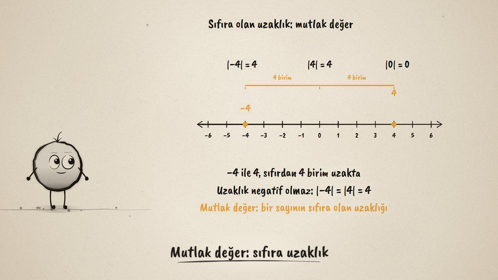
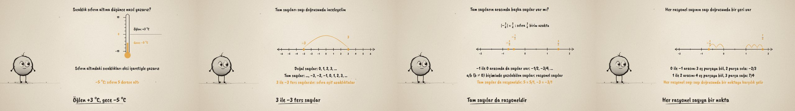

# Sıfırın İki Yanı · Integers and Rational Numbers

**▶ Tarayıcıda izleyin / Watch in the browser:** https://hakanatas.github.io/sifirin-iki-yani/ 
**⬇ MP4 + altyazılar / MP4 + subtitles:** [Releases](https://github.com/hakanatas/sifirin-iki-yani/releases) 
**✎ Kullanılan istem / The prompt behind it:** [PROMPT.md](PROMPT.md) 
**🎞 Bütün filmler / All films:** [Nokta'nın Filmleri](https://hakanatas.github.io/nokta-filmleri/?sinif=7)

> **TR —** 7. sınıf matematik "Sayılar ve Nicelikler (1)" temasındaki MAT.7.1.1 öğrenme çıktısı için hazırlanmış, tamamen JavaScript ile çizilen 92 saniyelik mürekkep animasyonu. Bir termometre: öğlen +3 °C, gece −5 °C; sıfırın altındaki sıcaklıklar eksi işaretiyle yazılıyor. Termometre yatırılınca bir sayı doğrusu oluyor: sıfırın sağında doğal sayılar, solunda negatif tam sayılar; 3 ile −3 sıfıra eşit uzaklıkta, ters sayılar. −4 ile 4'ün sıfıra uzaklığı 4 birim: mutlak değer bir sayının sıfıra olan uzaklığı (|−4| = |4| = 4, |0| = 0). Sayı doğrusuna yakından bakınca tam sayıların arasında da sayılar görünüyor (−1/2, −3/4, 3/2): a/b (b ≠ 0) biçiminde yazılabilen sayılar rasyonel sayılar; tam sayılar da rasyonel (5 = 5/1), |−3/4| = 3/4. Son olarak −2/3 ve 7/4 aralıklar eş parçalara bölünerek sayı doğrusuna yerleştiriliyor: her rasyonel sayı bir noktaya karşılık gelir. Altyazılar Türkçe, İngilizce ya da ikisi birlikte seçilebilir.

A 92-second ink animation for **7th-grade maths**. Nokta, the ink character from [The Learning Ink](https://github.com/hakanatas/the-learning-ink), is the guide again. The whole film uses one number line (`line` in `scenes/scene1.js`) whose range is a function of time: it runs from −6 to 6 for the integers, then zooms to −2…2 so the gaps between integers open up for the fractions.

## Learning outcome

MEB, Türkiye Yüzyılı Maarif Modeli, Ortaokul Matematik, 7th grade, "Sayılar ve Nicelikler (1)" theme:

**MAT.7.1.1. Gerçek yaşam ya da matematiksel durumlarda doğal sayı, tam sayı ve rasyonel sayıları yorumlayabilme**
- a) Tam sayıları inceler.
- b) Tam sayıları rasyonel sayılara genişletir ve mutlak değerle sayı doğrusunda açıklar.
- c) Sayı doğrusu üzerinde her rasyonel sayının bir noktaya karşılık geldiğini açıklar.

## Scenes

| # | Time | Scene | What happens | Outcome |
|---|---|---|---|---|
| 1 | 0–10 s | Sıfırın altı | A thermometer: +3 °C at noon, −5 °C at night. | a |
| 2 | 10–28 s | Tam sayılar | Natural numbers, then negative integers; 3 and −3 are opposites. | a |
| 3 | 28–46 s | Mutlak değer | −4 and 4 are both 4 units from 0: \|−4\| = \|4\| = 4, \|0\| = 0. | b |
| 4 | 46–64 s | Rasyonel sayılar | Zoom in: −1/2, −3/4, 3/2; a/b with b ≠ 0; 5 = 5/1; \|−3/4\| = 3/4. | b |
| 5 | 64–80 s | Her sayıya bir nokta | −2/3 and 7/4 placed by splitting a unit into equal parts. | c |
| 6 | 80–92 s | Aklında kalsın | Integers, absolute value, rational numbers. | a–c |

## Running it

- **Preview:** double-click `index.html` (it works offline).
- **MP4:** run `npm install` once, then `npm run export -- --format=horizontal --captions=tr`.
- **Subtitles and narration:** `npm run srt` writes `out/captions_*.srt` and `narration_notes.txt`.
- **Editing:**
  - Caption text, timings and narration notes: `captions.js`
  - Everything on screen is drawn by `LI.world(t)` in `scenes/scene1.js` (the thermometer, the number line, the brackets, the words); the other scenes only set the camera.
  - Nokta's poses: `src/draw/film.js`; layout for 16:9 and 9:16: `src/draw/kd.js`

It uses the same engine as The Learning Ink: `renderFrame(t)` as a pure function of time, seeded randomness, and frame-by-frame export.

## Lisans · License

**TR —** Bu film ve kodu [Creative Commons Atıf-GayriTicari 4.0 Uluslararası (CC BY-NC 4.0)](https://creativecommons.org/licenses/by-nc/4.0/deed.tr) lisansıyla paylaşılır. Ticari olmayan her amaçla (derste, okulda, eğitim materyalinde) kopyalayabilir, paylaşabilir ve değiştirebilirsiniz; ancak **kaynak göstermek zorunludur**: eser sahibinin adı ve bu deponun bağlantısı belirtilmeden kullanılamaz. Ticari kullanım (satış, ücretli ürün ya da yayın) için izin alınmalıdır.

**EN —** This film and its code are licensed under [Creative Commons Attribution-NonCommercial 4.0 International (CC BY-NC 4.0)](https://creativecommons.org/licenses/by-nc/4.0/). You may copy, share and adapt them for non-commercial purposes, but **attribution is required**: they may not be used without crediting the author and linking to this repository. Commercial use requires permission.

Atıf örneği / Required credit: *“Sıfırın İki Yanı”, Hakan Ataş, Nokta'nın Filmleri — https://github.com/hakanatas/sifirin-iki-yani — CC BY-NC 4.0*
